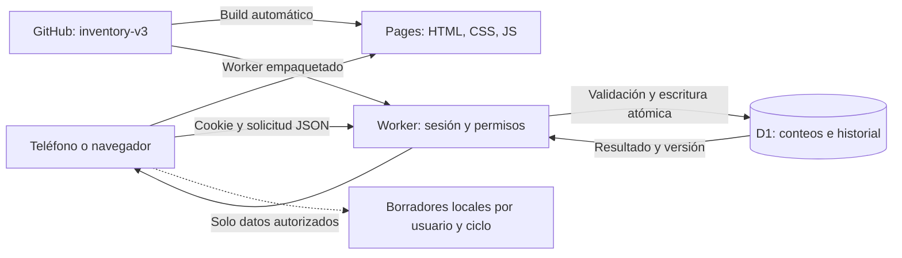
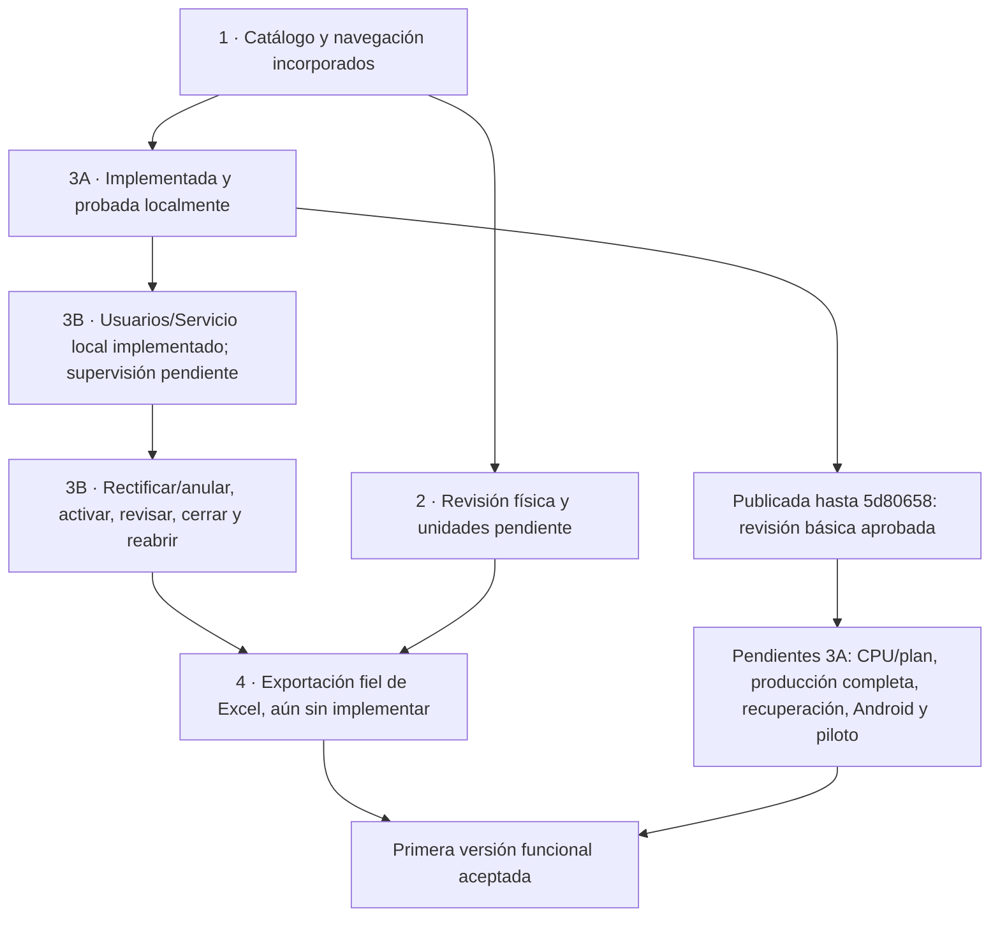

# Tecnologías y recorrido hasta la primera versión funcional

Estado actualizado el **22-10-2026**, rama `inventory-v3`, último código comprobado en el dominio `5d80658`. Este resumen complementa el [roadmap](roadmap.md); los resultados y límites de cada ensayo están en [verificación](verification.md).

## Qué usa la aplicación y para qué

| Tecnología | Función en este proyecto |
| --- | --- |
| HTML, CSS y JavaScript nativos | Pantallas móviles, formularios, navegación, temas, skeletons y transiciones. Sin framework de interfaz. |
| SVG | Iconos y progreso con apariencia consistente, incluidos menú, ojos y controles. |
| API HTTP/JSON y Fetch | Comunicación del navegador con el servidor del mismo origen; cantidades confirmadas solo después de respuesta aceptada. |
| Cloudflare Pages | Publicación del sitio desde GitHub: compila con `build:pages` y sirve `dist`. |
| Cloudflare Workers | Ejecuta la API y protege rutas: identidad, permisos, validaciones, guardados y sincronización. En Pages se empaqueta como `_worker.js`. |
| Cloudflare D1 / SQLite | Persistencia compartida de usuarios, sesiones, ámbitos, ciclos, conteos, operaciones, historial y auditoría. Triggers validan y aplican cada conteo atómicamente. |
| bcryptjs 3.0.3 | Derivación de contraseñas con sal y coste 12. Nuevas contraseñas: mínimo ocho caracteres; presupuesto CPU del plan real pendiente de validar. |
| Cookies HttpOnly/Secure/SameSite | Sesión autenticada; el navegador no guarda su secreto en localStorage. El servidor resuelve rol y permisos. |
| localStorage | Borradores aislados por usuario/ciclo, preferencia de tema y espera del refresco. Conserva datos locales antiguos sin importarlos. No sustituye D1. |
| Consultas incrementales con cursor | Sincronización de cambios autorizados, cada cinco segundos con pantalla visible; se pausa al ocultarse. Sin WebSockets ni Durable Objects. |
| Node.js 24, npm, Wrangler y workerd | Herramientas de desarrollo, dependencias, compilación y ejecución local del entorno Workers/D1. |
| esbuild 0.28.2 | Empaqueta el servidor para Pages, sin cambiar la interfaz a otro framework. |
| Playwright 1.56.1, pruebas Node y Python | Recorridos de navegador, API/integración, concurrencia, contrato del libro y primer administrador. Bases de ensayo separadas de desarrollo/producción. |
| Git y GitHub | Historia y ramas. Los pushes de `inventory-v3` disparan la integración de Pages; `inventory-v2` conserva la base anterior. |
| Libros Excel originales | Referencia de filas, identificadores, unidades y reparto físico; no se modifican. El generador de salida es futuro, etapa 4. |

Las versiones de dependencias están fijadas en `package.json`; Node es una herramienta local/build y Workers usa su propio runtime en producción. La arquitectura actual no promete conteo offline completo. El refresco manual del menú admite un intento cada 30 segundos por usuario en el navegador; reutiliza sincronización reciente/en curso y no envía borradores. Ese control no equivale a una cuota global del servidor.

## Recorrido de una operación

## Dónde vamos

La revisión física de etapa 2 y los pendientes de aceptación de 3A pueden avanzar en paralelo al desarrollo de 3B. El piloto del equipo está aplazado por decisión del usuario; no impide implementar 3B. El diagrama muestra dependencias y trabajo pendiente, no fechas ni aprobación operativa.

| Etapa | Qué está incorporado o comprobado | Qué falta |
| --- | --- | --- |
| 1 — Catálogo y navegación | Jerarquía real y navegación móvil; contrato de **1.151 filas** con cero diferencias en ID, nombre, unidad y categoría. **1.227 entradas de conteo** por distribución en ubicaciones. | Las decisiones físicas/unidades se mantienen en etapa 2. El contrato no prueba exportación. |
| 2 — Revisión operativa | Grupos prácticos separados de referencias de salida; pendientes identificados. | Cinco unidades de Pastelería, 18 entradas de Barra sin referencia, dos conversiones y organización física de Mercadito. Sin equivalencias inventadas. |
| 3A — Usuarios y conteo compartido | Cuentas/ámbitos, aislamiento, guardados propios, Descartar/Sumar/Sobrescribir, historial, reintentos, borradores y UX. Suites locales de API/navegador/HTTPS/recuperación. Simulación local: **15 clientes, 496 solicitudes, cero errores inesperados, 14 conflictos esperados**. | Aceptación operativa: CPU/plan/consumo, conteos y permisos entre varias personas en el dominio, atributos de cookie allí, recuperación remota/copia externa, Android y piloto. Transición revisada de datos locales antiguos pendiente. |
| Publicación actual de 3A | **16/16 GET anónimos**; revisión real de ingreso/cierre administrativo, Cuenta, menú, temas, refresco limitado y lectura de cuentas. Código público comprobado contra `5d80658`. | Esta revisión no certifica carga de producción ni sustituye las comprobaciones operativas anteriores. |
| 3B — Supervisión y administración | Incremento de usuarios y Servicio implementado y probado localmente, con migraciones y ciclo nuevo. [Contrato](usuarios-y-servicio-3b.md). Orden y criterios en [etapa-3b.md](etapa-3b.md). El servidor ya rechaza escrituras en ciclo no abierto, probado localmente en 3A. | Tablero, historial administrativo avanzado, rectificación/anulación auditadas, activación operativa y flujo de revisión/cierre/reapertura. **El tablero y esas mutaciones de conteo siguen sin implementar.** |
| 4 — Excel | Estructura original y referencias conservadas como contrato de salida. | Generación y validación del libro: solo cantidades, consolidación de ubicaciones con conversiones aprobadas, estructura/fórmulas/referencias intactas. **No implementada.** |

La primera versión funcional completa requiere terminar 3B y 4, resolver lo aplicable de etapa 2 y aprobar los pendientes operativos de 3A. Desactivar un producto no confirma cero ni borra filas del Excel. Anular o rectificar conservará auditoría; no se autoriza destruir historial. Pedido, SMS/correo y conteo offline completo quedan fuera de esta versión.

## Qué leer para continuar

- [Contexto y decisiones confirmadas](project-context.md), [accesos](accesos-y-administracion.md) y [guía visual](style-guide.md).
- [Pendientes y recuperación de 3A](cierre-tecnico-3a.md), [verificación detallada](verification.md) y [operación local](operacion-3a.md).
- [Primer incremento de 3B y sus límites](etapa-3b.md).
- [Despliegue automático y revisión del sitio](despliegue-pages.md). Los cambios solo documentales no requieren migraciones ni volver a crear el administrador.
